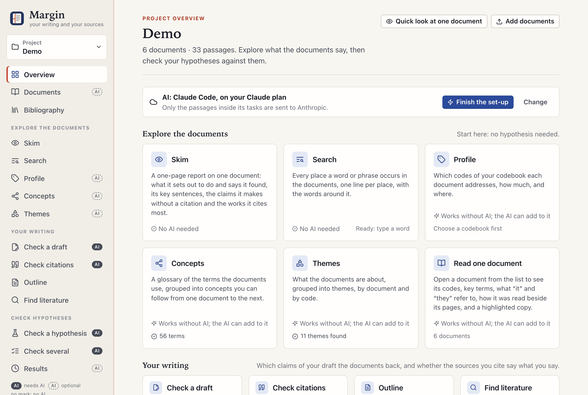
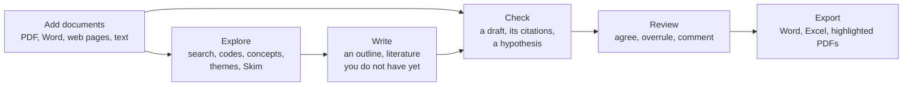

# Margin manual

Margin is a research and paper-writing companion for your own sources. It **checks your draft**: it finds the claims
that need a source and shows which of your documents support or contradict each, and checks that the works you cite
say what you say. It helps you **explore** your documents (every place a word occurs, the codes of a codebook, the
concepts and themes across them), **outline** a text from them and **find literature** you do not have yet. And it
**checks a hypothesis** against them. Most of it needs no AI; where an AI judges a passage, every quoted word is
checked against the source.

## How it fits together

Three things hold everywhere:

- **Your judgement wins.** You review the AI's judgements as you would a co-coder's. Yours replace the AI's, always
  count, and are kept beside the AI's in every download.
- **Every quote is checked.** A judgement whose quote is not word for word in the source is sent back to the AI and
  never used.
- **You decide what the AI may read.** The AI is Claude, through Claude Code on your own Claude plan; only the
  passages in its tasks leave your computer. Any document or draft can be kept to a model on your own computer, or
  from AI altogether, and an installation can rule out the cloud for good.

## Five-minute start

1. **Install**: paste one line in Terminal or PowerShell, or double-click a file. → [Install and update](manual/install.md)
2. **Set up Claude**: press *Set up Claude* on the first screen; it installs Claude Code and signs you in. No Claude
   plan? Choose a model on your computer. → [First steps](manual/first-steps.md)
3. **Add documents**: name a project, choose files or a folder, and say who may read them with AI.
4. **Check your draft**: under *Your writing*, *Check a draft*: paste it or choose its file, let Margin find the
   claims that need a source, and check them against your documents. → [Check a draft](manual/drafts.md)
5. **Review**: each claim shows the documents that support or contradict it, with their quotes; agree, or judge
   differently. → [Read and review a result](manual/review.md)

## The manual

| | Page | What it covers |
| --- | --- | --- |
| **Get going** | [Install and update](manual/install.md) | The one-line install, the files to double-click, scanned PDFs, updating, the icon |
| | [First steps](manual/first-steps.md) | The first screen, adding documents, finding your way in the app |
| **Explore the documents** | [Explore your documents](manual/explore.md) | Search, Profile and codebooks, Concepts, Themes, a document's panels, Quick look |
| | [Skim one document](manual/skim.md) | A one-page report: aims, findings, key sentences, claims, the works it cites |
| | [How documents are read](manual/reading.md) | What is read and what is left out, the reading view, moving to a new reader |
| | [Your bibliography](manual/bibliography.md) | Zotero next to your documents: what you have, what to find |
| **Your writing** | [Check a draft](manual/drafts.md) | Your draft's claims checked against your documents, the draft against itself |
| | [Check citations](manual/citations.md) | Whether the works you cite say what you say they do |
| | [Make an outline](manual/outline.md) | A writing plan from a research question or from your themes |
| | [Find literature](manual/literature.md) | Works you do not have yet, looked up online without AI |
| **Check hypotheses** | [Check a hypothesis](manual/check.md) | What a check does, the answers, hypotheses in parts, checking many at once |
| | [Read and review a result](manual/review.md) | The result page, excerpt cards, second opinions, downloads, the map |
| **The AI and your privacy** | [Privacy](manual/privacy.md) | What leaves your computer, who may read each document with AI, how it is enforced |
| | [Claude Code](manual/claude-code.md) | Starting it, its speed and helpers, the queue; Claude in a chat (the connector) |
| | [A model on your own computer](manual/local-models.md) | Getting one, choosing and tuning it, testing it |
| | [Which model does what](manual/models.md) | The model of each task and of each Claude plan; what every answer records |
| **Reference** | [Settings](manual/settings.md) | The five tabs, new versions early, reporting a problem, installing for others |
| | [Projects and other computers](manual/projects.md) | Managing projects, zips, moving to another computer, projects from ENLENS |
| | [Glossary](manual/glossary.md) | The words of the app and their technical names |
| | [Troubleshooting and limits](manual/troubleshooting.md) | Problems by topic, with their fixes; what Margin cannot promise |
| | [The command line](manual/command-line.md) | `margin-gui`, `margin` and the project's database |

## I want to…

| I want to… | Go to |
| --- | --- |
| find the claims in my draft that need a source | [Find the claims](manual/drafts.md#1-find-the-claims) |
| see whether the works I cite say what I say they do | [Check citations](manual/citations.md) |
| plan a chapter from my research question | [From a research question](manual/outline.md#from-a-research-question) |
| find literature I do not have yet | [Find literature](manual/literature.md) |
| get the gist of one paper quickly | [Skim one document](manual/skim.md) |
| find every place a word occurs | [Search](manual/explore.md#search) |
| see which codes of a codebook each document addresses | [Profile](manual/explore.md#profile) |
| test whether my documents back a statement | [Check a hypothesis](manual/check.md) |
| overrule the AI on an excerpt | [An excerpt card](manual/review.md#an-excerpt-card) |
| know which AI models a result used, for a methods section | [Notes and downloads](manual/review.md#notes-and-downloads), [What every answer records](manual/models.md#what-every-answer-records) |
| keep a licensed PDF, an interview or my draft away from Claude | [Who may read each document with AI](manual/privacy.md#who-may-read-each-document-with-ai) |
| use Margin with no cloud at all | [A model on your own computer](manual/local-models.md), [For whoever installs Margin](manual/settings.md#for-whoever-installs-margin) |
| fix a document that reads badly | [The reading view](manual/reading.md#the-reading-view) |
| see which works of my Zotero library I still need to find | [The four lists](manual/bibliography.md#the-four-lists) |
| bring my projects over from ENLENS | [Bringing projects over from ENLENS](manual/projects.md#bringing-projects-over-from-enlens) |
| move Margin to a new computer | [Moving to another computer](manual/projects.md#moving-to-another-computer) |
| make Claude Code go faster, or easier on my plan's limits | [How fast it works](manual/claude-code.md#how-fast-it-works) |
| update Margin | [Update](manual/install.md#update) |
| report a problem | [Reporting a problem](manual/settings.md#reporting-a-problem) |

---

This manual describes the current version of Margin. What changed in each version is in the
[changelog](../CHANGELOG.md).
