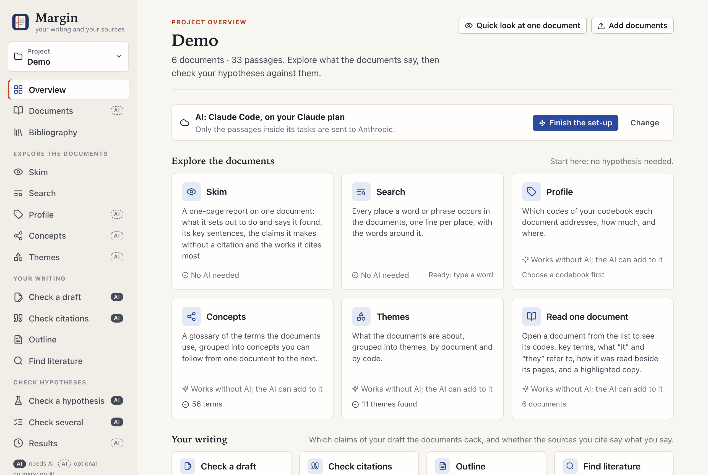
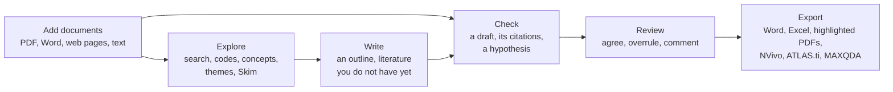

# Margin manual

Margin is a research and paper-writing companion for your own sources. It **checks your draft**: it finds the claims
that need a source and shows which of your documents support or contradict each, and checks that the works you cite
say what you say. It helps you **explore** your documents (every place a word occurs, the codes of a codebook, the
concepts and themes across them), **outline** a text from them and **find literature** you do not have yet. And it
**checks a hypothesis** against them. Most of it needs no AI; where an AI judges a passage, every quoted word is
checked against the source.

## How it fits together

Three things hold everywhere:

- **Your judgement wins.** You review the AI's judgements as you would a co-coder's. Yours replace the AI's, always
  count, and are kept beside the AI's in every download.
- **Every quote is checked.** A judgement whose quote is not word for word in the source is sent back to the AI and
  never used.
- **You decide what the AI may read.** The AI is Claude, through Claude Code on your own Claude plan; only the
  passages in its tasks leave your computer. Any document or draft can be kept to a model on your own computer, or
  from AI altogether, and an installation can rule out the cloud for good.

## Five-minute start

1. **Install**: paste one line in Terminal or PowerShell, or double-click a file. → [Install and update](manual/install.md)
2. **Set up Claude**: press *Set up Claude* on the first screen; it installs Claude Code and signs you in. No Claude
   plan? Choose a model on your computer. → [First steps](manual/first-steps.md)
3. **Add documents**: name a project, choose files or a folder, and say who may read them with AI.
4. **Check your draft**: under *Write*, *Check a draft*: paste it or choose its file, let Margin find the claims that
   need a source, and check them against your documents. → [Check a draft](manual/drafts.md)
5. **Review**: each claim shows the documents that support or contradict it, with their quotes; agree, or judge
   differently. → [Read and review a result](manual/review.md)

Want a walk-through with sample documents? [Your first project, start to finish](manual/first-project.md).

## The manual

| | Page | What it covers |
| --- | --- | --- |
| **Get going** | [Install and update](manual/install.md) | The one-line install, scanned PDFs, updating |
| | [First steps](manual/first-steps.md) | The first screen, adding documents, the sidebar, the finder |
| | [Your first project](manual/first-project.md) | A walk through six invented documents, to the Excel file |
| **Explore the documents** | [Explore your documents](manual/explore.md) | Search, Codes, Concepts, Themes, theory and working documents, Quick look |
| | [Concepts and the concept map](manual/concepts.md) | The glossary, links, named groups, the picture |
| | [Make your own codebook](manual/codebooks.md) | From the themes, theory, a copy or a CSV |
| | [Skim one document](manual/skim.md) | A one-page report: aims, findings, key sentences, claims |
| | [Look at how a document was read](manual/reading.md) | The reading view, *Leave out*, a new reader |
| | [Your bibliography](manual/bibliography.md) | Zotero next to your documents, retractions |
| **Write** | [Check a draft](manual/drafts.md) | Your draft's claims checked against your documents |
| | [Check citations](manual/citations.md) | Whether the works you cite say what you say |
| | [Make an outline](manual/outline.md) | A writing plan from a question or your themes |
| | [Find literature](manual/literature.md) | Works you do not have yet, looked up without AI |
| **Check hypotheses** | [Check a hypothesis](manual/check.md) | Writing one, the answers, parts, many at once |
| | [Read and review a result](manual/review.md) | The assessment in words, excerpt cards, downloads, the map |
| **Notes and decisions** | [Notes, the research log and earlier versions](manual/notes-and-log.md) | Highlights, the log, compare and restore |
| **How it works** | [How a check reaches its answer](manual/how-a-check-works.md) | The steps, how sure the AI must be |
| | [How documents are read](manual/how-documents-are-read.md) | What is read and left out, the readers, measuring |
| | [How the AI is used and limited](manual/how-the-ai-is-used.md) | Where it is used, how it is checked |
| **AI and privacy** | [Privacy](manual/privacy.md) | What leaves your computer, who may read each document |
| | [Claude Code](manual/claude-code.md) | Starting it, speed, the queue; Claude in a chat |
| | [Codex and Antigravity](manual/other-agents.md) | Other plans |
| | [A model on your own computer](manual/local-models.md) | Getting, tuning and testing one |
| | [Which model does what](manual/models.md) | The model of each task; what every answer records |
| **Reference** | [Settings](manual/settings.md) | The five tabs, reporting a problem |
| | [Projects and other computers](manual/projects.md) | Zips, a new computer, projects from ENLENS |
| | [Glossary](manual/glossary.md) | The words of the app and their technical names |
| | [Troubleshooting and limits](manual/troubleshooting.md) | Problems by topic, with their fixes |
| | [The command line](manual/command-line.md) | `margin-gui`, `margin` and the project's database |

## I want to…

| I want to… | Go to |
| --- | --- |
| find the claims in my draft that need a source | [Find the claims](manual/drafts.md#1-find-the-claims) |
| see whether the works I cite say what I say they do | [Check citations](manual/citations.md) |
| plan a chapter from my research question | [From a research question](manual/outline.md#from-a-research-question) |
| find literature I do not have yet | [Find literature](manual/literature.md) |
| find every place a word occurs | [Search](manual/explore.md#search) |
| see which codes of a codebook each document addresses | [Codes](manual/explore.md#codes) |
| test whether my documents back a statement | [Check a hypothesis](manual/check.md) |
| overrule the AI on an excerpt | [An excerpt card](manual/review.md#an-excerpt-card) |
| see what was decided in a project, and when | [The research log](manual/notes-and-log.md#the-research-log) |
| write a methods section, or an ethics application | [METHODS.md](METHODS.md), [PRIVACY.md](PRIVACY.md) |
| keep a licensed PDF, an interview or my draft away from Claude | [Who may read each document with AI](manual/privacy.md#who-may-read-each-document-with-ai) |
| fix a document that reads badly | [The reading view](manual/reading.md#the-reading-view) |
| see which works of my Zotero library I still need to find | [The four lists](manual/bibliography.md#the-four-lists) |
| bring my projects over from ENLENS | [Bringing projects over from ENLENS](manual/projects.md#bringing-projects-over-from-enlens) |
| move Margin to a new computer | [Moving to another computer](manual/projects.md#moving-to-another-computer) |
| open my work in NVivo, ATLAS.ti or MAXQDA | [For NVivo, ATLAS.ti and MAXQDA](manual/explore.md#for-nvivo-atlasti-and-maxqda) |
| report a problem | [Reporting a problem](manual/settings.md#reporting-a-problem) |

---

This manual describes the current version of Margin. What changed in each version is in the
[changelog](../CHANGELOG.md).
