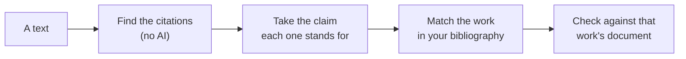

[Manual](../MANUAL.md) › Check citations

# Check citations

> **In short**
> - Margin reads a text for its citations and checks each against the work it cites: does the source say what your
>   sentence says?
> - It needs your bibliography: a citation is matched with a work there, and checked against that work's document in
>   the project, and against no other.
> - The answer is a prompt to look, and your judgement of the excerpts overrules it.

*Check citations* (sidebar, under *Your writing*, beside *Check a draft*) reads a text for its citations and checks each
one against the source it cites. It needs the project's bibliography ([Your bibliography](bibliography.md)).

Your own writing has one home: a text you paste or choose here is kept as a draft (with its name and AI setting), so
[*Check a draft*](drafts.md) can also show which of its statements still need a source, and every draft's citations
are listed here. A text without any citation is not kept. A draft's citations lead back to it (*Back to your draft*,
*Open your draft*); they are removed with the draft, on its page.

## A text to check

Paste your draft, choose its file (Word, PDF, text, Markdown or a saved web page), or pick a document of the project
(a report whose citations you want to check). A file is read on this computer and does not become one of the
project's documents, so it never turns up as evidence in another check.

For a draft, say who may read it with AI, as for documents: *Claude may read it*, *Only a local AI* or *No AI* (the
project's choice is preselected; you can change it later at the bottom of the summary). A document keeps its own
setting ([Privacy](privacy.md#who-may-read-each-document-with-ai)). *Find the citations* reads the text at once; no AI
is used for that, and nothing is checked yet.

## What it finds

Citations with an author and a year, in brackets or in the sentence:

- *(Smith, 2020)*, *(Smith & Jones 2019; Lee et al., 2021a, p. 4)*, *(e.g., WHO, 2021)*;
- *Smith (2020) found that …*, *According to Lindqvist et al. (2025), …*, *The World Health Organization [WHO] (2019)
  warned …*;
- numbered citations (*[3]*, *[2, 4–5]*) when the text ends with its numbered reference list; without the list, the
  page says how many it could not read.

The reference list itself is never read as citations, nor are *(Figure 3, 2020)* and the like.

### The claim of a citation

For each citation Margin takes **the claim** it stands for: the words before a citation in brackets (from the start of
the sentence, or from the citation before it in the same sentence: *X rose (A, 2020), while Y fell (B, 2021)* gives *X
rose* to A and *Y fell* to B), or what follows a citation in the sentence (*Smith (2020) found that X*: X). The claim is
highlighted in its sentence on the page. The sentences before it go along as **context**, so the AI understands *it*
and *this effect*; the context is never graded or quoted as evidence.

### Which work it is

A citation is matched with the bibliography by its first author's surname and the year:

- the second author decides between two works of one author in one year; *2020a* and *2020b* follow the order of
  their titles;
- *van der Berg* and *Berg* are the same name, *Müller* and *Muller* too, and *WHO* is found for the World Health
  Organization;
- a work cited with another year is not taken, but offered (a wrong year in the draft is worth a look);
- a citation introduced by *but see* or *contra* is cited for another view: it is left out of the checks (*Left out*,
  at the bottom, with *Put it back*).

## The answers

Four tiles count them. The main button, *Check 12 citations* (the number is how many are ready), checks every citation
that is ready, one after the other: by Claude Code, through the queue, as any check ([Claude Code](claude-code.md));
you can leave the page. Each cited work gets its own check: a sentence citing three works gets three, one per source.

| Tile | Means |
| --- | --- |
| **Source accurate** | An excerpt of the source says what the sentence says, and none says the opposite. |
| **To look at** | The source does not (fully) say it: see below. |
| **Cannot be checked yet** | The work or its document is missing: see below. |

**To look at** comes with a notice:

- *Only partly supported by the source*: it says part of it (a narrower finding, another group or period, a weaker
  version). Reword the sentence, or add a source for the rest.
- *Not found in the source*: none of the excerpts read says it. The source may say it in other words: open the
  excerpts and *Look for more evidence*, or check that the right work is cited.
- *The source says otherwise*, *The source says both*, *Unsure*, and *The check did not work* (with *Check again*).

Each shows the sentence, the cited work, and the excerpt that shows the answer best, with its page.

**Cannot be checked yet** names what is missing:

| Notice | What to do |
| --- | --- |
| *Not in your bibliography* | Choose the work from your bibliography, or *Not a citation*. |
| *Which work is it?* | Several works match: choose one. |
| *Its source is not in the project* | Add its document on the Bibliography page, under *To find* ([Your bibliography](bibliography.md#the-four-lists)). |
| *Its document waits for your confirmation* | Confirm it on the Bibliography page. |

Once that is done, the citation is ready: works and documents added later are used without adding the text again.

## Judging and downloading

*See the excerpts and judge them* opens the check on the result page, with *In your text:* and the sentence at the
top, and every excerpt to agree with, mark as not about it, or judge differently ([Read and review a
result](review.md)). Your judgement changes the answer on the Citations page too.

*Download: Excel (.xlsx)* gives one row per cited work: the sentence, the claim checked, the citation, the work, the
answer, the quote and its page. *Remove this text* removes the text, its citations and their checks; your file and your
documents are not touched.

Checks of citations are kept apart from your hypotheses: they are not in *Results*, the evidence map or its downloads.

## What it sends

Each check sends what a check of a hypothesis sends: the claim (with its sentences as context) and excerpts of the
cited source, to the AI of *Settings*. A draft marked *Only a local AI* is read by the model on this computer only
(also when Claude Code is your AI); one marked *No AI* is judged by you (every excerpt waits for your judgement); and a
document keeps its own setting. The search words a check asks the AI for are asked only when the text may go to that
AI. Checks of a text Claude may not read are never shown to a Claude chat through the connector.

## What it does not do yet

> [!NOTE]
> Footnote citations (*Chicago* notes), superscript numbers and citations inside a Word file's footnotes are not read;
> a numbered citation needs its reference list in the same text.

The claim is cut from the sentence by rules, not by the AI: when it starts with *it* or *they*, the context says what
they are, and the answer is yours to overrule. A text that changed is added again (remove the old one).

---

Next: [Make an outline →](outline.md)
