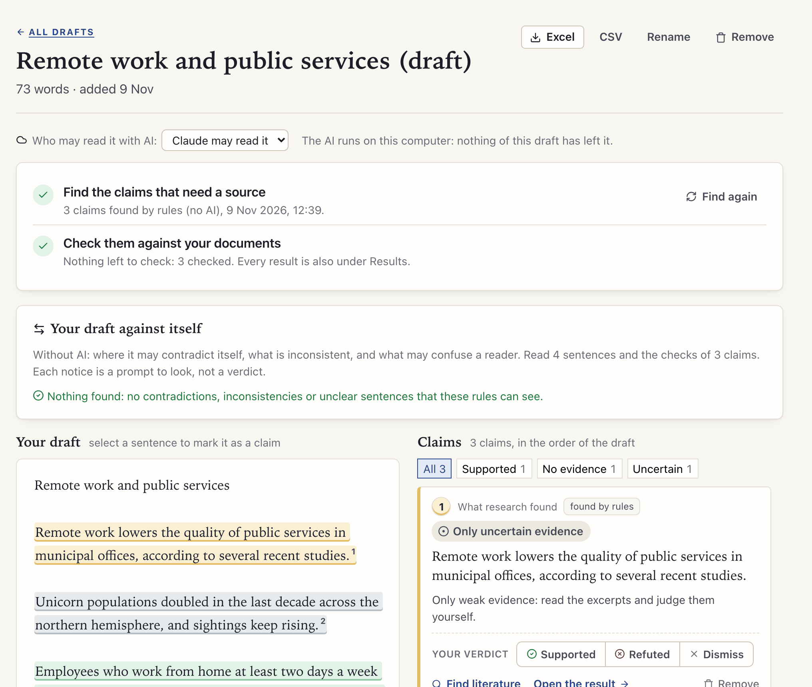
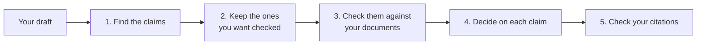

[Manual](../MANUAL.md) › Check a draft

# Check a draft

> **In short**
> - Paste or load what you are writing, and Margin marks the statements a reader would want a source for, then checks
>   each against all your documents.
> - Decide on every claim yourself (*Supported*, *Refuted*, *Dismiss*): the card then tells you what to cite, and
>   with a bibliography you can copy the citation.
> - Your draft is kept apart from your documents: it is never used as evidence. One marked *Only a local AI* or *No AI*
>   is never sent to Claude.

**Check a draft** (sidebar, *Your writing*) is for what you are writing yourself: a section, a chapter or a whole
paper.

## Adding your draft

Paste it or load it (Word, PDF, text, Markdown or a web page), and say who may read it with AI, as for a document:
*Claude may read it*, *Only a local AI* or *No AI* ([Privacy](privacy.md#who-may-read-each-document-with-ai)). The
draft is kept apart from the documents: it is never used as evidence in a check. When you add a draft, Margin also
finds its citations ([step 5](#5-check-your-citations-against-their-sources)).

## The steps

### 1. Find the claims

The AI reads the draft a few paragraphs at a time and marks the statements a reader would want a source for: numbers
and trends, causes and effects, comparisons, what research found, general claims about the world, definitions and
histories. It leaves out your own aims, methods, arguments and results, questions and headings.

Each claim quotes its sentence exactly (the quote is checked against your draft like every other quote), is restated
as one self-contained sentence ("it" replaced by what it stands for), and says whether your draft already cites a
source there. Without AI (a draft marked *No AI*, or *Only a local AI* with no local model chosen) rules find the
likely ones instead, and the page says so.

### 2. Keep the ones you want checked

- *Dismiss* (under *Your verdict*) a statement that is not a claim.
- *Reword* a claim before it is checked: what is checked is that wording.
- Select a sentence in the draft and press *Mark as a claim* to add one.
- *Find again* finds the claims anew and keeps every one you checked, decided on, dismissed, reworded or marked.

### 3. Check them

Each claim is checked against all the documents as a hypothesis of its own: one claim, no splitting, and AI search
words only when the AI may read the draft ([Check a hypothesis](check.md)). The draft then shows each claim coloured
by its answer. Each card lists the documents that support it, partly support it or contradict it, with the best quote
and its place, and what to do next ("cite them", "your documents disagree: cite both sides"). *Open the result* gives
the full result page, where you review the excerpts as for any check ([Read and review a result](review.md)).

### 4. Decide on each claim

At the foot of every card, *Your verdict* is one switch of three: **Supported**, **Refuted** and **Dismiss** (press the
chosen one again to take it back). Under it are the card's links (*Find literature*, *Open the result*, or *Check this
one* and *Reword* before a check), with *Remove* at the far end. You can decide before or after a check.

The card then folds to what you need: its number, your decision, the claim, and what to cite (the documents that
support it, or the ones that contradict it, or *Your draft cites a source here*). *More* opens it again and *Undo*
takes the decision back.

In the draft, the sentence loses its colour fill and gets an underline (green for supported, red for refuted) with a
small tag **cite here** where the citation goes (*cited* when your draft already gives one); a dismissed claim is
only dotted. Your decision belongs to the draft: the answer on the claim's result page does not change.

The filters above the claims add *To decide*, *You: supported* and *You: refuted*. Claims you decided on are left out
of *Check N claims*; open the card and press *Check this one* to check one anyway.

*Find literature* on a card looks for works for that claim ([Find literature](literature.md)).

### 5. Check your citations against their sources

No AI is used to find the citations, such as *(Smith, 2020)*, *Smith et al. (2020) found that …* and *[3]* (with a
numbered reference list at the end of the text). A third step on the draft page counts them, and **Check N
citations** checks each cited work whose document is in the project against that document only: does the source say
what your sentence says? What each answer means is on [Check citations](citations.md#the-answers).

In the draft, each citation is underlined by its answer:

| Underline | Means |
| --- | --- |
| Solid green | The source says it. |
| Wavy red | The source says otherwise, or both. |
| Wavy amber | It says only part of it, or the excerpts read do not say it. |
| Dotted | It waits, or cannot be checked yet. |

The claim a citation stands for shows it under **Your citation**, with *See the excerpts*, *Check this citation*, or
*What it needs* (a work to choose, a document to add). So a cited claim tells you two things: what all your
documents say about it (step 3), and whether the source you cite says it (this step).

The filter *Citation to look at* shows the claims whose source needs a look, and a folded card names your citation
and its answer. *Review every citation* opens the draft on the *Check citations* page, where you choose the work of
a citation or leave one out. The checks of the draft's citations keep the draft's AI setting, as its claims' checks
do, and *Remove* removes them with the draft.

## Your draft against itself

Between the steps and the draft, a card reads the draft against itself, without AI, using its sentences and what
Margin already has for it (the claims, their checks, your decisions). It opens on what needs a look first.

| Notice | What it finds |
| --- | --- |
| **May contradict each other** | Two sentences about the same thing that go opposite ways ("costs fell" and "costs rose", "effective" and "ineffective") or where one says "not"; the same statement with two numbers ("grew by 40%" and "grew by 25%"); one passage of a document that supports one claim and contradicts another; two claims that say nearly the same thing but got opposite answers, or that you marked one supported and the other refuted. |
| **Inconsistent** | An abbreviation used before it is spelt out, or spelt out two ways; one word written two ways ("organisation" and "organization", "data set" and "dataset"). |
| **May confuse a reader** | A claim that opens with "This" or "These" and a verb ("This shows …"), one that is careful and absolute at once ("probably … certainly"), and one long sentence holding several claims. |

Contrasts you draw on purpose are left out: a sentence opening with "However", "In contrast" and the like close by, a
view you report in order to answer it ("Some argue …"), two different works cited for the two sides, sentences naming
different things ("costs in Europe" and "costs in Japan"), or two different years. Your reference list is not read.

Click a quoted place to highlight it, with the notice's other places, in your draft. A claim's card also names the
notices it is in ("May contradict claim 6"); clicking that opens the notice. **Not a problem** sets a notice aside; it
stays aside while those sentences are the same, and *Show … set aside* brings it back.

> [!NOTE]
> Each notice is a prompt to look, not a verdict: the rules are careful rather than complete, so a contradiction
> worded very differently is not found.

## Citations to paste

With a bibliography on the *Bibliography* page (your Zotero library or a collection, or a file exported from a
reference manager; [Your bibliography](bibliography.md)), every document a claim would cite that is linked to a work
of the bibliography has its APA 7 in-text citation next to it, such as **(Verhoeven & Okafor, 2025)**.

- Click it to copy it, then paste it into your text.
- Alt-click (Option-click on a Mac) copies the narrative form, *Verhoeven and Okafor (2025)*.
- A folded card has one button for all the documents to cite, in one parenthesis and in APA's order: *(Adeyemi &
  Brandt, 2024; Verhoeven & Okafor, 2025)*.

The citations follow APA 7 as your reference list would:

- one or two authors by name, three or more as *et al.*, editors when there are no authors;
- *n.d.* without a year; *2024a* and *2024b* for two works of the same authors and year;
- as many names as needed when two *et al.* would read the same;
- a work without an author is cited by the first words of its title (in quotation marks for an article, a chapter or
  a web page; in italics for a book or a report, which come along when pasted into Word).

A document not linked to a work has no citation: the card says so and links to *Bibliography*, where you can link it.
The citation is made from what Zotero holds: an author or year missing there is missing in the citation too.

## Working in the page

On a wide window the draft and the claims scroll on their own: scroll through the claims and the draft stays where it
is. Click anywhere on a claim's card (not on its buttons or links) to show its sentence in the draft, and click a
sentence in the draft to bring its card into view.

## Downloads, and what is sent

*Excel* and *CSV* download one row per claim: the sentence, the claim checked, whether it is cited, the answer, your
decision and the documents on each side, as a list of what to cite, with their APA 7 citation when you have a
bibliography. They gain *Your citations* and *What the cited source says*. The checks are also under *Results*, as a
set ([Read and review a result](review.md#all-your-results)).

A draft marked *Only a local AI* or *No AI* is never sent to Claude, in finding its claims or in any task of their
checks, and is hidden from a Claude chat. For a draft Claude may read, the page says how much of it Claude has read
and when.

---

Next: [Check citations →](citations.md)
