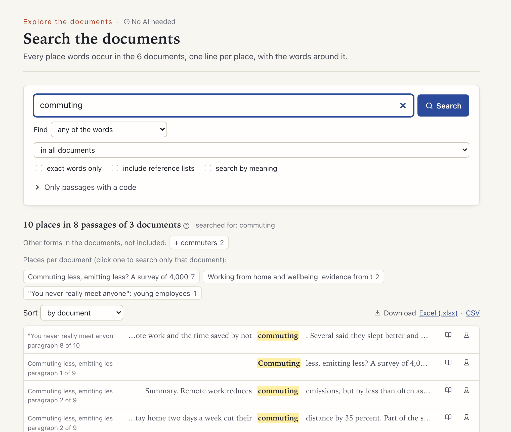
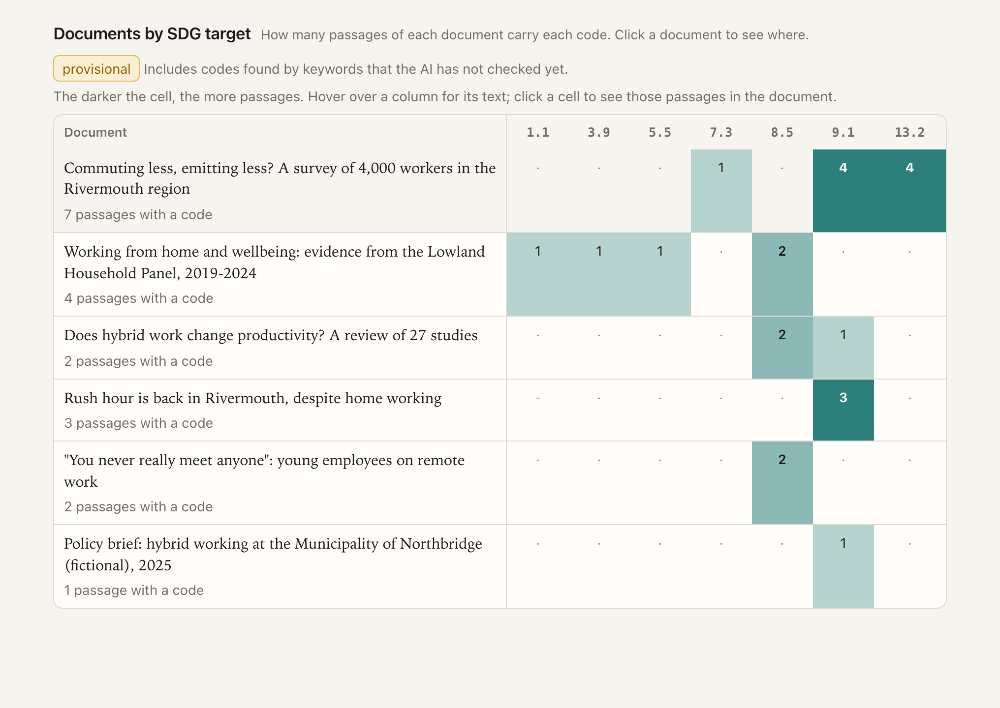
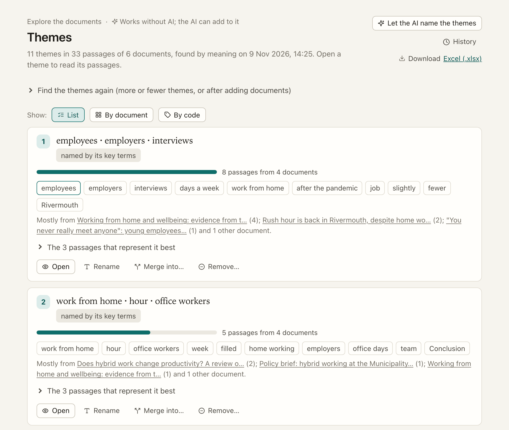

[Manual](../MANUAL.md) › Explore your documents

# Explore your documents

> **In short**
> - Before or beside checking, the places in the sidebar's **Explore** group show what your documents say and where.
> - Search, key terms, the keyword codes, the glossary and themes by words need **no AI**. The AI only adds
>   readings on top, and each one quotes the text and is checked against it.
> - Margin has **no default codebook**: *Codes* asks you to choose one. Every line, code and theme opens the
>   document at its place.

| Place | What it gives | AI? |
| --- | --- | --- |
| [Skim](skim.md) | A one-page report on one document, to skim it before deciding to read it | no |
| [Search](#search) | Every place words occur, with the words around them; phrases, near, other forms, words nearby; Excel/CSV | no |
| [Codes](#codes) | The codes of a codebook each document addresses, how much and where, with the words or quote and reason behind each | keywords first; the AI confirms |
| [Concepts](concepts.md) | A glossary of terms grouped into concepts (abbreviations, wordings, your links), and where each appears | optional |
| [Themes](#themes) | Themes across the documents, by document and by code; rename, merge, move, remove | optional (names) |
| [A document](#in-a-document) | Its codes, key terms, references ("it", "they"), search, a highlighted copy, how it was read | references only |

## Search

Every place words occur, one line per place with the words before and after (a concordance), with the count per
document first.

| You want | Do |
| --- | --- |
| Any of the words, all of them in one passage, a phrase, or words near each other | Choose it under *Find* (*near*: within N words). In a phrase search, words typed next to a "quoted phrase" must also be in the passage. |
| Other endings too ("price" finds "prices") | The default. *Exact words only* turns it off. Forms the search did not include are listed under the count (*Other forms in the documents: commuters*), to add with one click. |
| To grow the search from what you see | Click a word in a line to add it; <kbd>Shift</kbd>-click to make a phrase. |
| To see patterns | Sort by document, by the words before or by the words after. |
| The words around your search | *Words that often appear nearby*: the words within 2 to 10 words of the places found, most often or most typical first (point at one for both figures; within one document or code, "typical" is measured against that document's or code's own passages). |
| To test what a line says | Its link *Check this* takes the line to *Hypotheses*, where you check it. |
| A list for later | Download every line for Excel or as CSV. |

Every searched word is marked in the lines, and in the passages that search by meaning finds. A line shows its
document's title; point at it for the place (page, paragraph). Click the title to open the document at its words. A *passage* is the stretch of text the app reads as one unit: a
paragraph, up to about 1,100 characters ([How documents are read](how-documents-are-read.md)). The place shown (page, paragraph) is
that of the original. Setting up search by meaning runs once per project: a second press, or a reload while it
runs, follows the same job.

*Search by meaning* is a tick box above the results. With no model chosen it stays off, and a line under the search box
leads to *Settings → Documents*. With a model chosen but the project not (fully) set up, the Search page itself says
so, with how much is covered and the button *Set up search by meaning* (the same job as on the Documents page, with
its progress); a job already running shows as progress, never a second button. When it ends the tick box can be used
at once, without reloading the page.

## Codes

*Codes* has two views, under the title: *By document* and *Codebooks* ([Make your own codebook](codebooks.md)).
*By document* shows which codes of a codebook each document addresses, how much and where. A **codebook** is a list of
codes, each with a description. Margin has **no default codebook**: you choose one, and *By document*, the *Codes*
panel of a document and the themes' code grid ask for it until you do. Choose a built-in one (*Social practice
theory*, *Framings of conduct and change*, the 169 SDG targets or their 17 goals), or one of your own
([Make your own codebook](codebooks.md)); [Settings → Exploring](settings.md#the-five-tabs) can set it to none again.

1. **Keywords first.** When documents are added, the app finds candidate codes in seconds by their keywords (and by
   meaning, with an embedding model): *provisional* codes.
2. **The AI confirms.** *Let the AI label the passages* has the AI read each passage with a candidate code and say
   which codes really apply (main topic or mentioned; for a codebook of aims, whether the passage says it helps or
   hinders the aim), with a quote and a reason. Afterwards it says how many keyword codes it confirmed, did not
   confirm, and added.
3. **You decide.** In a document, the **Codes** panel shows every code with its passages, quotes, reasons or the
   words that found it (highlighted in the text). Agree, change how it applies, reject (with *Undo*), or add a code
   of your own. Your labels always count: a keyword label you agreed with or changed stays even after the AI has
   read the passage.

Count by code or by group (a codebook's groups). The grid opens the passages behind each cell; a long grid draws its
first documents at once and the rest as you scroll down (or *Show more documents*). *Technical details* shows the
model, its exact version (digest), the prompt and the seed, and warns when they differ from the last run.

### Codebooks with more to say

Besides `code` and `description` (and `group`, `group_name`), a codebook's CSV may have these columns:

| Column | What it holds |
| --- | --- |
| `keywords` | Words and phrases separated by `;`, found as whole words |
| `include` | When to use the code |
| `exclude` | When not to, and which code to use instead |
| `source` | Where the code's definition comes from |

The AI reads `include`, `exclude` and `source` with each code. A codebook of 30 codes or fewer is sent to the AI whole
with every passage, and the AI reads every passage by default (*Options* switches it), since a keyword search misses
codes whose words are not in the text. *Codebooks* (a view of *Codes*) shows all of it, code by code.

The JSON file next to the CSV

A JSON file with the same name as the CSV (ending `.json`) may give:

| Key | What it does |
| --- | --- |
| `title`, `label` | The codebook's name |
| `directional` | The codes are aims that a passage can help or hinder |
| `direction_labels` | Your words for helps, hinders and mixed |
| `direction_note` | What the direction is relative to |
| `one_main` | At most one main code per passage |
| `practice_and_element` | Each label also names the practice and the element |
| `stance`, `sources` | How the codebook is meant to be used, and where it comes from |

### Social practice theory

Two built-in codebooks follow practices rather than topics.

**Social practice theory** (25 codes): elements (EL: materials, competences, meanings), performing the practice (PF),
knowing (KN), rules, resources and power (RP), dynamics of links made, sustained and broken (DY), and connections
between practices (NX). A label says whether the passage **holds the practice together** or **pulls it apart**, and
names the practice and the element in the passage's words. "When the night nurse left, nobody switched the table on
again and the games stayed in the cupboard" is DY3 *Breaking links*, DY6 *Learning and careers* and EL1 *Materials*
(the games), all pulling apart.

- *Count by → Practice* shows practices by code, each with its elements.
- A concept's page lists the labels that name it (*In codebook labels*), and its links can say how elements relate:
  needs, shapes, replaces, is an element of, clashes with (*Ask the AI how they relate in a practice*, under *Often
  mentioned together*).

**Framings of conduct and change** (4 codes, one main code per passage): whether a text explains what people do
through practices, individual choice, structure or system, or technology by itself. Run it on policy documents.

> [!NOTE]
> These concepts are sensitising, not a formula (Nicolini 2012: 240). Labels on interview transcripts record what
> people say about their practice; fieldnotes code better, and *practical consciousness* (KN1) fits only where a
> speaker marks their knowing as tacit.

Concepts that show only across a body of material (a practice's trajectory, proto- and ex-practices, the duality of
structure) are not codes. Check them as hypotheses ([Check a hypothesis](check.md)), tagged with a code: "Use of the
table lasted only where a staff member made it part of the daily care routine" (DY2).

When you change the codebook, a notice above the grid says so: the codebook changed since the keyword pass (*Find the
codes again* takes seconds), codes were reworded after the AI labelled with them, or labels of removed codes wait and
are not counted. *Open the codebook* goes to its editor ([What happens to labels](codebooks.md#what-happens-to-labels)).

## Concepts

The glossary of concepts and the concept map have a page of their own: [Concepts and the concept map](concepts.md).

## Themes

What the documents are about, grouped into themes. Each theme has key terms, a size, the documents it comes from and
the passages that represent it best; grids show themes by document and by code. The same documents and settings
always give the same themes (spherical k-means on the passages' embeddings, or on their terms without an embedding
model). A small project gets fewer themes than asked: about three passages a theme.

- **Rename, merge, move passages.** Your edits are kept, and carried to a new set with the same settings after
  documents were added: an edit follows its theme by the passages they share, and stays behind when no theme of the
  new set has them.
- *Let the AI name the themes* gives names and short descriptions, with checked quotes.
- **History** on a set of themes lists its earlier versions, to compare and restore
  ([Earlier versions](notes-and-log.md#earlier-versions)); removing a theme or a set asks *Why?* for the research log.
- **Remove** a theme that is not relevant to you (running headers, reference lists, a topic outside your question):
  its passages are left out of the themes, the grids and the downloads. It waits under *Removed themes* at the foot
  of the list, where *Bring it back* undoes it.
- **Remove and find a new theme** also looks for a new theme in its place, on this computer and without AI.

How <i>Remove and find a new theme</i> chooses

Among the passages that fit their own theme least well, it finds the group that sits closer to a new centre than to
the theme it is in, and names it by its key terms. It never takes passages closer to a theme you removed. A new theme
says which theme it replaces; removals and new themes belong to that set of themes only.

## In a document

A document's page shows its text as the reader found it ([How documents are read](how-documents-are-read.md)), with panels beside
it:

| Panel | What it does |
| --- | --- |
| **Codes** | Every code with its passages ([Codes](#codes)). |
| **Key terms** | The terms that set the document apart; point at one to underline it in the text. |
| **References** | *Follow the references*: the AI reads the document three passages at a time and links "it", "they" or "the study" to the name they stand for. Select a name in the text to see every later mention. |
| **Search** | Search within the document. |
| **Notes** | Your highlights and notes on this document's words ([Notes, the research log and earlier versions](notes-and-log.md#highlights-and-notes)). |
| **Reading**, **Page** | How well it was read, and the original page beside the text ([How documents are read](how-documents-are-read.md)). |

*Download a highlighted copy* gives the PDF with highlights for the judgements, codes, concepts or references you
choose (exact boxes with the `pdfminer` extra, whole lines otherwise, text recognition for scanned pages), and a note
listing any quote it could not place. Other documents come as an HTML copy.

*Rename…* (on its page, and in its row on the Documents page once you open it) gives the document a title of your own.
It is used everywhere in the project: the Documents list, results, Search, the bibliography and exports. It stays when
the bibliography links the document to a work, or a new reading finds another title; *Use the title it had before*
gives back the work's title, or the one read from the file. The file, its text and every result stay as they were,
and the research log notes the change.

### Theory documents

A book or paper your research is read *through* (a theory of practice, a systems text) is not evidence about your
field. Mark it as **theory**: in *Documents*, a row's menu → *Mark as theory…*, or on the document's page,
*More* → *Mark as theory…*. A small *Theory* tag then stands beside its title.

A theory document is still read, searched (*Search* finds it), opened and noted as any other. It is **left out** of
the themes, the labelling with codebooks, the excerpts a check reads, key terms and the glossary's counts, and so of
the evidence map. You mark it; Margin never guesses: a study that *uses* a theory is still evidence. A check you
limit to the theory document by hand still reads it.

Marking or unmarking changes no result by itself. The document's page lists what was made with it in (sets of themes,
codebook labels, checks), with links to make them again without it; a check is run again from its own page. *Mark as
evidence* takes the mark back. A theory is also where a codebook can start
([Make your own codebook](codebooks.md#make-one)).

**Many documents at once.** In *Documents*, tick the documents, then *Role* in the bar at the foot of the window:
*Evidence*, *Theory* or *Working document*. A role every ticked document has already is greyed out. Margin asks once,
then marks them all; *Undo* in the message gives each document the role it had. The research log keeps one entry
naming the documents. A *Non-scientific* mark stays as it is.

### Working documents

Your own draft or notes can be kept in the project beside the corpus. Mark it as **your working document**:
in *Documents*, open a row → *Role* → *Mark as my working document…*, or on the document's page, *More* → *Mark as
my working document…*. A *Working document* tag then stands beside its title. Another author's draft you study is
evidence, not your working document.

A working document is read, searched, opened, noted and labelled with your codebooks as any other, but it is **never
a source**: it is left out of the themes, the excerpts a check reads, key terms, the glossary's counts and the
evidence map. Its codes show on its own page and as its own row at the foot of the *Codes* grid, never in the
corpus's counts, so you see what your draft covers beside what the corpus does.

To check one of its claims, select the sentence in its text and choose **Check against the corpus**. *Hypotheses*
opens with the words filled in: turn them into the claim you want to check, then press *Check*. A line above the box
says that the check will be listed on the document's page and who will read these words, by the document's AI
setting:

- *Claude may read it*: the AI you chose, as for any hypothesis.
- *Only a local AI*: only a local model on this computer reads the words and the excerpts they are checked against
  (Claude reads none of them); without a local model, you judge the excerpts yourself. With Claude Code as the AI,
  the hypothesis is checked as written, without parts or other search words.
- *No AI*: no model reads the words. Margin finds the excerpts with the words as written, and you judge them.

A check from a document marked *Only a local AI* or *No AI* is not shown to a Claude chat connected to Margin. The
document's page lists every check started from it, newest first, each with its answer now (the first eight, the
others under *and N more checks*), and each check's page links back to the document. The check remembers the
document, not the sentence. A box of several lines is a list, which is not tied to the document.

A document has one role: evidence, theory or your working document.

### Non-scientific documents

A news article, a press release, a company brochure or a blog reports no method or data of its own. Mark it as
**non-scientific**: in *Documents*, open a row → *Scientific* → *Mark as non-scientific…*, or on the document's page,
*More* → *Mark as non-scientific…*. A newspaper icon then stands beside its title in the list.

It stays in everything a theory document leaves: themes, codebook labels, the excerpts a check reads and key terms.
Its excerpts are still read and judged, and shown with *Not counted: non-scientific*, but **no judgement of them
counts in an answer**, yours neither. On their own they make a hypothesis neither supported, nor mixed, nor
contradicted: a hypothesis only non-scientific documents support reads *No scientific evidence found*. Beside a
scientific study they change nothing: a study that partly supports it and a press release that fully supports it give
*Partly supported*. The assessment under the answer says what the non-scientific documents say, and what the answer
would be counting them.

Unlike the theory mark, this one **changes answers at once**: the dialog says how many checks read the document, and
afterwards the document's page lists each check with its answer now and the answer counting the non-scientific
documents, or, for a check set to count them, *counted in this check (set on the hypothesis)*. *Count as scientific*
takes the mark back. A document can be theory and non-scientific at once. You mark it; Margin never guesses. Do not
mark documents that are your material: when you study what newspapers or companies say, they are your evidence.

**When they are the material of one hypothesis.** Some hypotheses are about what newspapers, blogs or companies say
(*Local newspapers framed the plant as a job engine*): there they are the evidence. Under the answer of such a
hypothesis, turn on **Count non-scientific documents in this check**. Its answer then counts them as any document, for
every part of it, and changes at once; every other check still leaves them uncounted. The page, the assessment under the
answer and the Excel download say plainly that they count here and why, with the answer the check would have without
them, and their excerpts read *Non-scientific, counted here*. The research log keeps each change with the answer before
and after. While it is on, a field under the switch takes your reason, if you want to give one: change it and choose
*Save reason*, or empty it to give the usual reason (*they are the material this hypothesis is about*) again; the
research log keeps each change. The switch is shown only where the check read a non-scientific document.

**A suggestion from your bibliography.** When a document's work in the [bibliography](bibliography.md) is a kind that is
usually not scientific (a newspaper or magazine article, a press release, a blog or forum post, a web page, a podcast
or a broadcast), its page and its row in *Documents* show one quiet line: *Your bibliography lists this as a newspaper
article. Mark it as non-scientific?* *Mark* opens the usual dialog; *No* keeps it as it is, and the research log keeps
your answer. Nothing is marked by itself, and theory and working documents are never suggested. You can take a *No*
back on the document's page with *Suggest again*. Grouping *Documents* by *Scientific or not* lists the suggested ones
together.

**On the evidence map** a non-scientific document has a column too: what it says is drawn with the symbol unfilled
and a dashed edge (*Non-scientific: read, not counted*). It changes no answer, count or colour of the map, and it
still counts among the documents with no excerpt that counts, as in *Documents* (*Behind no answer*). In a
hypothesis that counts them, its cells are drawn as any other. The Excel summary has the answer counting them,
filled where it differs, and whether the hypothesis counts them.

## In a result

A quote that starts with "it" or "they" says what it refers to (*"it" = green hydrogen*); when the AI did not say, the
excerpt is flagged *The quote begins with "it": check what it refers to*. *Highlighted copy* on an excerpt, *Highlighted
documents (.zip)* in the downloads, and *highlighted* under each document of the evidence map give the documents with
the quotes marked ([Read and review a result](review.md)).

## Quick look

*Quick look at one document* (on the Overview, on *Skim* and on *Manage projects*) reads one file into a temporary
project and opens its [Skim](skim.md) report: search it, see its codes and references at once. A banner offers *Keep as
a project* or *Discard now*; otherwise it goes to the trash after 7 days. A quick look opened while a project is open
can use that project's codebooks, without changing them; its own labels stay in the quick look.

## For NVivo, ATLAS.ti and MAXQDA

*NVivo, ATLAS.ti, MAXQDA (.qdpx)* (beside *Download all* on the Hypotheses page, beside *Excel* on the Codes page, and
among a result's downloads; `margin export-qdpx` on the command line) downloads the project in the REFI-QDA exchange
format that these programs open. It holds every document as plain text (without the blocks left out), each codebook
with labels and your own codebooks as codes with their definitions, and each hypothesis as a code with *Supports*,
*Partly supports* and *Contradicts* under it. The labels and judgements that count are codings on their quotes: you
code your own decisions, and "Margin AI" with the model's name codes the AI's, so you can tell them apart in the other
program. Your notes and highlights become memos on their words, and the research log one memo. A codebook alone
downloads as a REFI-QDA codebook from the codebook's page (*Download as .qdc*). No AI is used, and nothing leaves the
computer.

## For FlexiConc

`margin export-flexiconc` ([The command line](command-line.md)) downloads the project as one SQLite file in the
FlexiConc layout: documents, sentences with their code, reference chains, theme clusters and, with an embedding model,
embeddings. The codes are those of the SDG targets unless you name another codebook with `--framework NAME`.

---

Next: [Skim one document →](skim.md)
