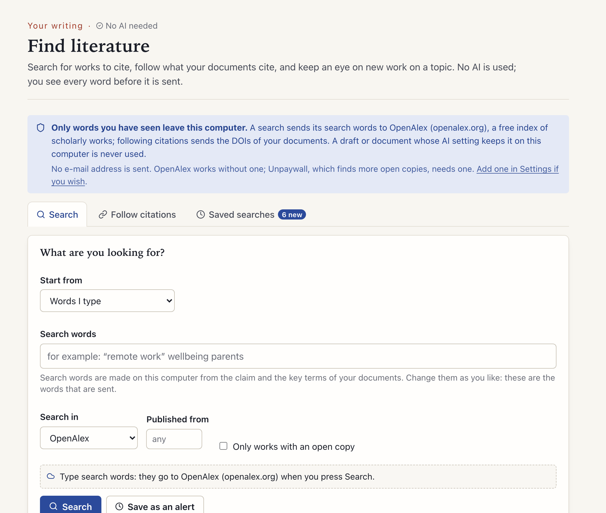

[Manual](../MANUAL.md) › Find literature

# Find literature

> **In short**
> - *Find literature* (in the sidebar, under **Your writing**) looks up works to cite online: for a claim of your draft
>   that no document supports, for the works your documents cite, or on a search you save.
> - It is not AI: it asks OpenAlex, a free index of scholarly works (or Crossref or Semantic Scholar), and the words it
>   asks with are made on your computer. You see and change them before anything is sent.
> - No text of a draft or document is ever sent. Tick works and send them to Zotero, or download them as RIS or BibTeX.

The page has three tabs: **Search**, **Follow citations** and **Saved searches**.

## Search

Start from a claim of a draft that no document supports (the draft page's *Find literature* button opens the page with
that claim, [Check a draft](drafts.md)), or type words.

1. Margin suggests search words from the claim and from the key terms of your documents. Change them if you like. The
   line under them says exactly what will be sent and to whom.
2. Pick *Search in* OpenAlex, Crossref or Semantic Scholar, a first year, and *only works with an open copy* if you
   wish.
3. Read the works. They are ordered by how close they are to your claim: by meaning when you have a local embedding
   model (*Settings → Documents*), otherwise by the words they share.

Works you already have are marked. An open copy is shown when OpenAlex knows one; *Look for open copies* asks Unpaywall
for the rest, which needs your e-mail address (*Settings → Exploring*).

## Follow citations

The works your documents cite and the works that cite them, from the DOIs of your documents (and of the works of your
[bibliography](bibliography.md) linked to them). They are ordered by how many of your documents they connect to, then
by how close they are to your themes.

*Show exactly what is sent* lists the DOIs. Documents whose AI setting keeps them on this computer are left out. The DOIs in a document's reference
list also show on its [Skim](skim.md) report.

## Saved searches

Keep a search, or write a research question: Margin makes search words from it and you change them.

- A saved search says how many works are *new since you last looked*. The Overview card shows the count.
- Margin checks searches when you open the page (those not checked for six hours) and when you press *Check now*.
  Nothing runs in the background.
- *Mark as seen* starts the next look from today.

## Choosing works

Tick works anywhere on the page. The bar at the bottom offers:

| Button | What it does |
| --- | --- |
| **Send to Zotero** | Uses Zotero's own connection on this computer. Zotero puts the works in the collection that is selected in its window, so open Zotero and select one first; the bar says which. |
| **RIS** or **BibTeX** | A file to import yourself. |
| *Let Zotero fetch the open PDFs* | Adds each open PDF to the work; Zotero itself downloads them. |

Then update the [bibliography](bibliography.md) to match the new works with your documents.

## What it sends, and what it never does

Margin sends:

- the search words;
- the DOIs of your documents, when you follow citations;
- your e-mail address, if you set one under *Settings → Exploring* (so the services can reach you if you ask for much;
  Unpaywall requires one). Margin never fills it in.

And it never sends:

- any text of a draft or document, and no AI reads anything;
- anything at all when cloud models are off for good on this computer (`--local-only`);
- a search from a draft unless the draft's setting is *Claude may read it*: for other drafts you type your own words.
  Documents with another setting are left out of *Follow citations*.

Answers are kept in the project so the same lookup is not repeated; *Ask again* asks the service again. More on what
leaves your computer: [Privacy](privacy.md).

## What it does not do yet

- It has not been tried against the real services by its authors' tests (they use stand-ins), so a change in OpenAlex's
  rules (it may ask for a key) can show as *refused*.
- A saved search lists at most 50 works per look, and uses OpenAlex.
- Following citations resolves at most 150 cited works.
- Crossref and Semantic Scholar are for searching only.

---

Next: [Check a hypothesis →](check.md)
