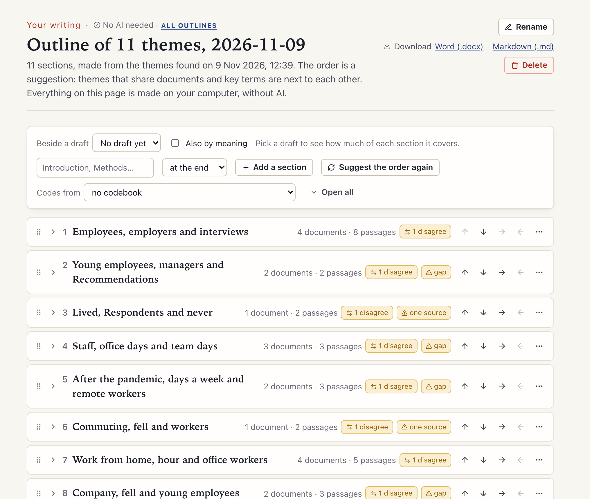

[Manual](../MANUAL.md) › Make an outline

# Make an outline

> **In short**
> - *Outline* (in the sidebar, under **Your writing**) turns your themes into a plan to write from: sections with
>   key terms, best passages, documents to cite and notes of your own.
> - Start **from a research question** and your hypotheses, so the outline follows your argument, or **from all the
>   themes**, one section for each.
> - It uses no AI: everything is made on your computer from what Margin already knows, so it gives the same outline
>   twice. Make it yours by moving, joining and splitting sections, then download it as Word or Markdown.

Open *Outline* in the sidebar, or press *Make an outline* on a set of [themes](explore.md#themes). You can make several
outlines.

## From a research question

*From a research question* is the first way offered. Write your research question and, if you like, hypotheses (up to
12, one per line, or pick ones you have [checked](check.md)). Each hypothesis becomes a section holding the themes that
bear on it most, so the outline follows your argument instead of listing every theme.

A theme bears on a hypothesis in three ways, strongest first:

| How | What counts |
| --- | --- |
| **Evidence first** | When a hypothesis has been checked, the passages its check counts for or against it show which themes it rests on, and those weigh most. A hypothesis section shows its answer (*Supported*, *Mixed evidence*…), the documents on each side with their citations, and *Open the result*. |
| **Then shared words** | A theme also bears on a sentence through its key terms. A term whose every word is in the sentence counts fully, one that shares some words half as much, and a word found in the key terms of many themes counts less (so "region" or "study" alone places nothing). A key term of the same concept as a word you used ([Concepts](explore.md#concepts)) counts fully too. |
| **By meaning, if you ask** | *Also by meaning* places themes close in meaning to a hypothesis, with the embedding model **on this computer**. The question is never sent to a model elsewhere. |

**Where each theme goes.**

- To the hypothesis it bears on most.
- Under *Background* when it bears on the question but on no hypothesis.
- Otherwise it stays out, under *Themes not in the outline*, with what it shares with the question.

Each theme section says **why it is here** (how many passages of the check, which key terms it shares) and which other
hypotheses it also bears on.

**A hypothesis you have not checked** is placed by its words only, and says so. *Check it* opens [Check a
hypothesis](check.md) with its wording; keep the wording and the outline finds the check (case, spaces and a final
full stop do not matter). *No theme bears on this hypothesis* means your documents say little about it, or say it in
other words.

**Later.**

- *Add a hypothesis* puts a new one before *Background*. It takes the themes that bear on it from *Background* and from
  the themes not in the outline, never from another hypothesis.
- *Reword* changes the question.
- *Suggest the order again* orders the themes inside each hypothesis and keeps your order of the hypotheses.

## From all the themes

*From all the themes* makes one section for each theme.

## One section for each theme

A section shows:

- the theme's key terms;
- the passages that represent it best, with their place in the document;
- the documents to cite, with an APA in-text citation such as *(Haugen, 2024; Okafor, 2023)* and a *Copy* button, when
  the documents are linked to your [bibliography](bibliography.md);
- the codes of your codebook that its passages carry ([Profile](explore.md#profile));
- the concepts its key terms belong to.

A heading comes from the theme: the name the AI gave it (*Themes → Let the AI name the themes*, optional), your own
rename, or else its first key terms.

**An order that reads as a path.** Themes that share documents and key terms sit next to each other. The outline
starts with the theme that has most passages and goes on to the most similar theme not used yet; each section says
what it shares with the next. The order is a suggestion: *Suggest the order again* puts the theme sections back in it
(sections of your own stay where they are).

## Make it yours

Drag a section by its grip to move it (top of another section: before it; bottom: after it; middle: inside it), or use
the arrow buttons.

| Button | What it does |
| --- | --- |
| *Move up*, *Move down* | Moves the section among its neighbours. |
| *Put inside the section above* | Nests it. Sections nest three levels deep. |
| *Take out of its section* | Brings it back one level. |
| Three dots → *Rename* | Gives it your own heading. |
| Three dots → *Join to another section* | The other gains its themes, notes and inner sections. |
| Three dots → *Split* | A section of several themes becomes one for each; a section of one theme is split by documents. |
| Three dots → *Take out of the outline* | Its theme waits under *Themes not in the outline*. |
| *Add a section* | Makes a section of your own, such as an introduction or the methods. |

Each section has a box for your notes. The outline is kept in the project, survives a reload, and stays when you find
the themes again or delete the set it came from (the sections keep their titles and notes).

## What each section tells you

- ***Where the sources disagree*** shows, side by side, the claims you checked in which the section's documents are on
  both sides (or on one side against documents elsewhere), with the quote and place of each.
- ***Gaps*** names a section with one source only, two sources, mostly one source or few passages.
- ***You decided*** lists what you decided about claims of a draft that these documents touch ([Check a
  draft](drafts.md)).

## Beside a draft

*Beside a draft* marks each section with how much of it your [draft](drafts.md) covers: its key terms found in your
words, and its sources found among the works your draft's own citations name. Opened, a section lists the sources not
cited yet, their passages, the key terms not used yet and where in the draft it is touched.

*Also by meaning* compares each draft paragraph with the section using the embedding model, only when search by meaning
is set up with a model on this computer; nothing is sent anywhere.

> [!NOTE]
> Without a bibliography no source can count as used, and the page says so ([Your bibliography](bibliography.md)).

## Download

*Word (.docx)* and *Markdown (.md)* give the outline as a document to write into: numbered headings, your notes, key
terms, the citation, quotes with their place, where the sources disagree, gaps, and the sources named. An outline made
from a research question adds the question, each check's answer and why each theme is there.

---

Next: [Find literature →](literature.md)
