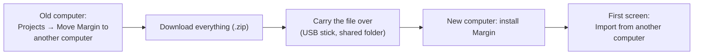

[Manual](../MANUAL.md) › Projects and other computers

# Projects and other computers

> **In short**
> - A **project** is one set of documents with everything made from them. *Download as a zip* puts one in a single
>   file; *Import a project (.zip)* opens it as a new project, on this computer or another.
> - *Move Margin to another computer* takes every project and your settings in one go.
> - Coming from ENLENS? *Bring it over* copies your ENLENS projects. ENLENS keeps its own.

## Managing projects

Open the project menu at the top of the sidebar and choose *Manage projects*. Each project keeps its own documents,
results and notes.

| Button | What it does |
| --- | --- |
| *New project* | Makes an empty project, for example one literature review. |
| *Import a project (.zip)* | Opens a project zip as a new project ([below](#import-a-project)). |
| *Open an existing Margin project folder* | Uses a project folder that Margin made earlier, on the command line or in another copy of the app, in place and without copying it. For technical users. |
| *Download as a zip* (on each project) | One file with the whole project ([below](#download-a-project-as-a-zip)). |
| *Remove* (on each project) | Asks you to type the project's name first. A project Margin made is moved to a trash folder inside the data folder; a project linked from another folder is only unlinked, and its folder is left as it was. |

**Where everything is.** Margin keeps its data in one folder, `~/margin` unless you chose another with `--home` or
`MARGIN_HOME`. The projects are in `~/margin/projects`, the settings beside them, and the logs (`logs/margin.log`,
`logs/update.log`) in `logs`. Keep this folder where it is backed up. The command line can work on any project folder
you name with `--ws` ([The command line](command-line.md#projects-claude-code-and-the-queue)). A project's folder also
has a `cache/` with what makes search faster: it is made from the documents, never goes into a zip, and can be deleted
at any time (the next search is a little slower, once). A folder that a cloud service copies (Dropbox, OneDrive) copies
it too; it can be left out there.

## Download a project as a zip

*Download as a zip* on the *Projects* page puts the whole project in one file: the database, the documents and their
original files, the codebooks and the notes you made. Use it for a backup, to give a project to someone, or to move it.

- The file of a document you removed stays on this computer: it is not in the zip.
- *Download the whole project (.zip)* is also on the *Results* page.
- From a terminal: `margin --ws myproject export-project myproject.zip`.

## Import a project

*Import a project (.zip)* opens such a file as a new project. Its name is proposed from the file name; if a project of
that name exists already, you are asked for another.

- A zip made with *Download as a zip*, on this or another computer, comes in whole.
- A project's folder zipped by hand (Finder's *Compress*, Windows' *Send to compressed folder*) works too: its
  documents are pointed at the unpacked copies.
- A damaged zip, or one whose database cannot be read, is refused with a plain message and leaves nothing behind.
- From a terminal: `margin import-project myproject.zip --ws copy_of_project`, into a new or empty folder.

Who may read each document with AI ([Privacy](privacy.md#who-may-read-each-document-with-ai)) comes with the project.
A zip made by an old ENLENS (before its 0.11) holds no such settings, so Margin asks once, on import.

## Moving to another computer

1. On the old computer open *Projects* and, under *Move Margin to another computer*, choose *Download everything
   (.zip)*. It makes one file with every project (each as its own project zip, with the original file of each
   document) and your settings.
2. Carry the file to the new computer.
3. Install Margin there ([Install and update](install.md)) and choose the file under *Import from another computer* on
   the first screen. Later, *Import a project (.zip)* on the *Projects* page takes both kinds of zip.

Each project keeps its name (`name (2)` when the name is taken). The settings come along only when the new computer
has no project yet, and on an installation without cloud AI (`--local-only`) never the choice of a cloud AI.

> [!NOTE]
> A saved Claude API key is left out: it stays on the old computer. So are quick looks you did not keep. Projects used
> in place from another folder come along as copies. Claude Code needs signing in again on the new computer (*Set up
> Claude*, [First steps](first-steps.md#1-the-ai)).

## Bringing projects over from ENLENS

Margin installs beside ENLENS ([Install and update](install.md#coming-from-enlens)) and does not change its folder.
When it finds ENLENS projects in `~/enlens` (or the folder in `ENLENS_HOME`), a card on the first screen and on the
*Projects* page lists them.

1. Quit ENLENS if it is open.
2. Press *Bring it over* (with several projects, *Bring all 3 over*). Margin copies the projects with their documents,
   results, judgements and codebooks, and your settings too when this is your first start.
3. Margin says how many projects are here now. ENLENS keeps its own and works as before.

Each project's database is copied with SQLite's backup. A project that ENLENS uses in place from another folder is
linked, so both apps open it. From a terminal, `margin import-enlens` does the same, and `margin import-enlens name1
name2` brings only those projects. Margin also opens ENLENS's own project zips and its *Move to another computer* zips
as they are. Projects made with ENLENS before its 0.11 keep *Claude may read it* for every document, so nothing
changes until you change it ([Who may read each document with AI](privacy.md#who-may-read-each-document-with-ai)).

What comes with an ENLENS project

The database file keeps its ENLENS name, `enlens.sqlite`, so that both apps read it. Results of ENLENS's SDG pack
(extracted claims, verifications) come along and stay in the database, but Margin does not use them. They are why
*Remove all documents* is refused on such a project ([Troubleshooting](troubleshooting.md#documents)).

