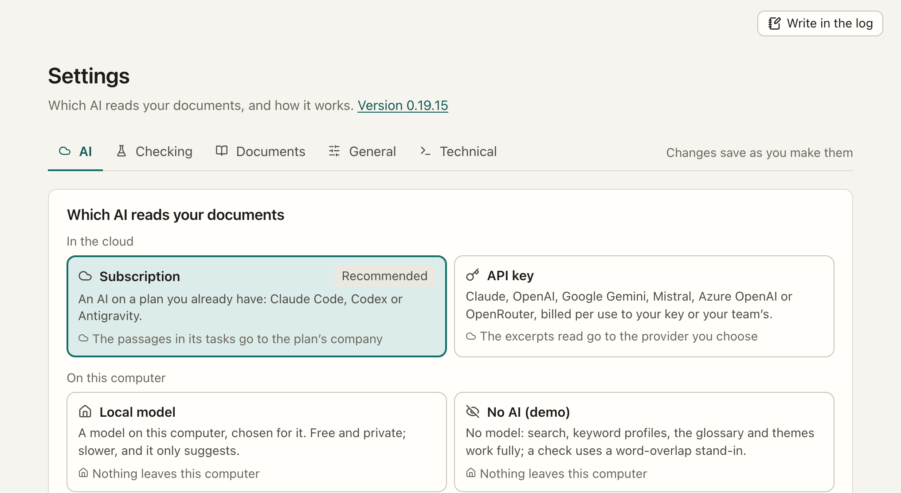

[Manual](../MANUAL.md) › Settings

# Settings, and setting Margin up for others

> **In short**
> - *Settings* has five tabs: **AI**, **Checking**, **Exploring**, **Documents** and **Technical**.
> - The version of Margin is at the top right of every tab; click it to look for updates.
> - Whoever installs Margin for others can make sure nothing ever leaves the computer.

## The five tabs

| Tab | What you set there |
| --- | --- |
| **AI** | **Work waiting for the agent** (what waits, in order: *Do first*, *Hold*, *Remove*; the helpers; [Claude Code](claude-code.md#following-the-work)). Which AI reads your documents, as five choices in two rows: **Subscription** (an agent on a plan you already pay for: Claude Code, Codex or Antigravity; [below](#subscription-claude-code-codex-or-antigravity)) and **Local model** (automatic, Ollama, or an OpenAI-compatible server such as LM Studio, with its address, model and reasoning switch); then **No AI (demo)**, the **Claude API (team key)** for a shared installation, behind a confirmation and *Allow cloud models*, and, after *Allow cloud models*, **Another cloud provider (API key)** ([below](#another-cloud-provider-with-an-api-key)). With a Subscription agent: its set-up card (for Claude Code the checklist with *Set up Claude*), *Let the auditor use Fable* (Claude Code), *How much thought*, *Helpers at once*, *At your plan's usage limit* and, with a local model for restricted documents, *The mix of local and Claude* (or of Codex, of Antigravity) ([Which model does what](models.md#the-mix-of-local-and-claude)). With a local model: *Install Ollama* (or *Start Ollama*) when no model server runs, *Download qwen3:8b* when none is installed, and the *Local model for restricted documents*. *Save and test* says whether the AI answers (with Claude Code, whether it is set up). |
| **Checking** | The **strictness**: how sure the AI must be before a judgement counts. It saves at once, applies to every result, and reports which answers and counts changed; *Back to normal (60%)*. Beside it, **how often you agreed with the AI, by its certainty**: a small chart from the excerpts you judged, and after 20 judgements perhaps a suggestion ("When the AI was at least 70% sure, you agreed with it in 85% … *Use 70%*"). Also how new checks start: other words, parts, how many excerpts to read, and at most how many from one document. And **When work has finished**: a notification from your computer when work you started that took more than 20 seconds has finished, or stopped with a problem, so you can close the browser while a local model works (Margin keeps working; a click on the notification opens it again). *When Margin is not in front* (the default) sends one only when no Margin tab is the one you are looking at; also *Always* or *Never*, and *Send a test notification*. On a Mac, the first one asks whether Margin may send notifications (System Settings › Notifications › Margin). |
| **Exploring** | The codebook of *By document* and how many themes a new set looks for (in a team project whose owner chose a default codebook, that one holds there, and its help line says *This project uses the team’s default*; your setting still holds in your other projects). A link to *Codes* › *Codebooks* leads to the page where you make, change and remove codebooks ([Make your own codebook](codebooks.md)). |
| **Documents** | **Reading scanned PDFs** (on or off, and the languages), and the embedding model for **search by meaning** (with *Download nomic-embed-text* when Ollama has none). |
| **Technical** | **AI model per task** ([Which model does what](models.md)): the model of each kind of task, what it steps up to, the helper on Claude Code, *Use the recommended models*, *The recommendations follow* your plan, and for local servers the small model for labels and links. With a local model, the **model for second opinions** and the **context length** (automatic by default), with *Sort the best excerpts again by wording* (off). **Repeatable results**: the seed (42 by default) and a test of whether the server gives the same answer twice. *Test a model* ([how](local-models.md#test-a-model-before-trusting-it)). **Updates** (*Check for updates*, how this copy was installed), **Your link to Margin** (*Copy my link*: the link with this run's key, for a bookmark; it works until Margin stops, and opens Margin for whoever has it, see [Privacy](privacy.md#what-goes-where)), where your data is, *What was sent to Claude*, **Which new versions to offer** and **Copy technical details**. |

### Subscription: Claude Code, Codex or Antigravity

The first choice answers on a plan you already pay for, with no API key. Its card names three agents, and you pick one
inside it. Each carries a mark where it fits.

| Agent | Your plan | Mark |
| --- | --- | --- |
| **Claude Code** | A Claude plan (Pro, Max, Team) | *Recommended* |
| **Codex** | A ChatGPT plan (Plus, Pro, Business) | |
| **Antigravity** | A Google account, free or paid; free: every task on Gemini 3.8 Flash | *Recommended on a free plan* |

Choosing Codex or Antigravity asks first, naming the company that then receives the passages inside the tasks, as
Claude Code does. *Set up Codex* (or *Set up Antigravity*) opens guided steps: install, sign in, add Margin
([Codex and Antigravity](other-agents.md#set-it-up-once)). The card then shows what is found, signed in and added, the
**models in use** per tier, *How much thought* and *Helpers at once*. A line says the agent is **not yet measured with
Margin**. Claude Code's own set-up, checklist and speeds are in [Claude Code](claude-code.md).

### Another cloud provider (with an API key)

The last main choice in *Settings → AI*, after the Subscription agents, a model on this computer, the offline demo and the
Claude API, is **Another cloud provider (API key)**: OpenAI, Google Gemini, Mistral, Azure OpenAI or OpenRouter, each reached through
its OpenAI-compatible chat API, over HTTPS only. It needs *Allow cloud models* (as the Claude API does), and is refused
where cloud models are switched off for good (`--local-only`).

- **The key, in guided steps.** Each provider has its own: pick it among the option cards (each shows *Key stored* or
  *Not set up*) and press *Set up OpenAI…* (or its name). A window leads you one step at a time: make an account (the
  address to open is shown to copy, not a link), add credit or a plan with API access where the provider needs one, make
  a key, and paste it. Where a key is made: [OpenAI](https://platform.openai.com/api-keys), [Google AI
  Studio](https://aistudio.google.com/apikey), [Mistral](https://console.mistral.ai/api-keys),
  [OpenRouter](https://openrouter.ai/keys); Mistral's billing is at
  [admin.mistral.ai](https://admin.mistral.ai/organization/billing); Azure's key and address are in the
  [Azure portal](https://portal.azure.com) after you deploy the models in [Microsoft Foundry](https://ai.azure.com). The
  key goes into the system's keychain (macOS Keychain, Windows Credential Manager, `secret-tool` on Linux; or a file only
  you can read where there is none; the page says which), never into `settings.json`, a log, an error message, the record of how an answer was
  made, or a *Move Margin to another computer* file. The page shows only whether a key is stored: *Change the key…* opens
  the window at its paste step, *Forget the key* removes it. Two things to know first: a ChatGPT plan pays for
  Codex (above), not for OpenAI's API, and on Google's free tier Google may use what is sent to improve its
  products, except in the EEA, Switzerland and the UK, where its paid terms apply to all use. The Claude API
  ([key page](https://platform.claude.com/settings/keys)) has the same steps.
- **Recommended models, applied automatically.** Margin picks three models from the provider's own current line-up,
  among the models your key may use: one for small tasks (labels and links), one for judging excerpts, one for second
  opinions and hard cases. Each row shows the model in use and *Recommended* or *Your choice*; choose another from the
  list only if you need to (the first entry, *Recommended*, goes back). A newer Margin brings newer models by itself.
  Azure has no list: type the names of your three deployments, with the recommended names as a hint
  ([the line-ups](models.md#the-recommended-models-of-each-provider)).
- **How much thought.** *Energy efficient*, *Balanced* and *Intelligence* work for every provider and agent: one model
  tier lower or higher, and less or more reasoning effort where the model takes it
  ([Which model does what](models.md#how-much-thought)).
- **Not yet measured.** Margin's default models and routing were measured on Claude only, and the page says so for
  these providers.
- **Who may read what.** Nothing goes to a provider until a document allows it: [Other cloud
  providers](privacy.md#other-cloud-providers). Its own terms decide what it keeps; check them.

Old links to a section (`#/settings/second`, `#/settings/calibration`…) open its tab.

## Trying new versions early

Margin offers full releases only, by default. From 0.16 on, a **release candidate** (a try-out of the next version)
comes out at least a week before each new version. To be offered candidates, choose *Try new versions early*
under *Settings → Technical → Which new versions to offer*; *Stable (recommended)* goes back. A copy installed from
git follows its branch and has no such choice.

> [!WARNING]
> Try a candidate on a project you do not share with colleagues: going back to the stable version can show sync
> clashes on what the candidate made (nothing is lost).

## Reporting a problem

*Settings → Technical → Copy technical details* copies a few lines for a problem report: the Margin version, how it
was installed, the system and Python, the AI route, whether cloud models are switched off, and the update channel.
Never a path, a project or document name, or a key. *Report a problem* opens a short form on GitHub (a free GitHub
account is needed) to paste them in; please paste no text from documents that must stay private.

A **security or privacy problem** is reported privately instead: see [SECURITY.md](../../SECURITY.md).

## For whoever installs Margin

- **The AI.** A new installation uses Claude Code on the researcher's own plan. To use a model on this computer
  instead, choose it once in *Settings → AI* (or let *automatic* find Ollama or LM Studio) and press *Save and test*;
  with Ollama running, *Download qwen3:8b* there gets a model without a terminal. An installation that already chose a
  local model keeps it when it is updated. With an embedding model set (*Settings → Documents*), new documents are
  indexed for search by meaning right away.
- **Nothing may ever leave the computer.** Start the app with `margin-gui --local-only`, set `MARGIN_LOCAL_ONLY=1`,
  or create an empty file named `local_only` in the data folder. The cloud options (the Claude API and Claude Code)
  are then hidden, the default becomes the local model (*automatic*), the app and its API refuse to switch to them,
  Margin never starts Claude Code, and the connector refuses to hand out queued tasks.
- **Backups.** Keep the data folder (`--home`) somewhere that is backed up: it holds the projects, their results and
  the settings.
- **The icon.** Install with the one-line install ([Install](install.md)): it makes the icon. With
  `MARGIN_LOCAL_ONLY=1` and `MARGIN_HOME=<folder>` before `sh`, both are built into the icon. From a git copy, make
  the icon with `margin-gui --make-launcher`, with the same `--home` and `--local-only` you would start it with.
- **Scanned PDFs** need Tesseract ([Install](install.md#scanned-pdfs-optional)). Settings shows whether it is
  available.
- **Starting it by hand**: `margin-gui` and its options are in [The command line](command-line.md#the-app).
