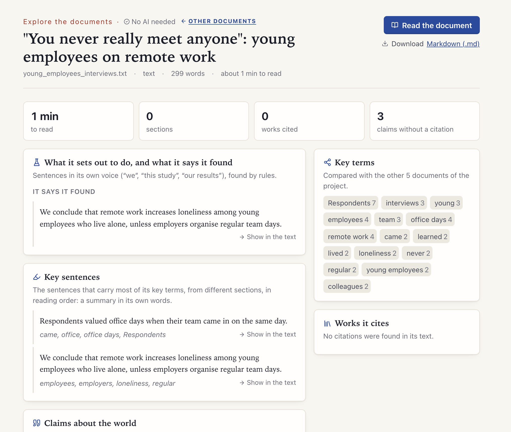

[Manual](../MANUAL.md) › Skim one document

# Skim one document

> **In short**
> - *Skim* (first under **Explore the documents**) is a one-page report on one document, for a publication you want to
>   skim before deciding to read it.
> - It is made on your computer without AI, from rules, counts and the document's own words, and it needs no other
>   document.
> - Every sentence opens the document at its place, and *Markdown (.md)* downloads the report as notes to keep.

## Opening a report

- **A document you already have:** choose *Skim* in the sidebar, or press *Skim it* on any document.
- **A file that is not in a project:** press *Quick look at one document* (on the start page, on *Skim* and on *Manage
  projects*). The file is read into a temporary project and lands on its report, so there is nothing to set up. A banner
  offers *Keep as a project* or *Discard now*; otherwise it goes to the trash after 7 days
  ([Quick look](explore.md#quick-look)). From a quick look, *Ask it something* leads to [Check a
  hypothesis](check.md) (which uses the AI) and to [Search](explore.md#search).

What compares documents elsewhere in Margin has a single-document version here.

## What each part means

| Part | What it shows |
| --- | --- |
| **At a glance** | Reading time (the words before the reference list, at 230 a minute), sections, works cited, and claims without a citation. |
| **Abstract** | Found under a heading *Abstract* or *Summary*, or a line starting with that word near the start. The keywords after it are left out. |
| **What it sets out to do, and what it says it found** | Sentences in its own voice ("we", "this study", "our results show", "we conclude"). A plan ("we will describe") is not a finding. |
| **Key sentences** | The sentences that carry most of its key terms, at most two from a section, in reading order: a summary in its own words. |
| **Claims about the world** | Statements of the kinds that usually need a source (numbers, causes and effects, comparisons, what research found, general claims), each marked with or without a citation. The list opens on *Without a citation*. |
| **Sections** | The sections, with the number of words in each. |
| **Key terms** | The terms that set the document apart. |
| **The works it cites most** | The works its text cites most often, and the DOIs in its reference list. |
| **Codes** | The codes of your codebook that it addresses, when you have chosen one ([Profile](explore.md#profile)). |

Three things are worth knowing:

- **Its own voice comes first.** [Check a draft](drafts.md) leaves these sentences out on purpose; here they come
  first.
- **A number in its own results is not a gap.** Claims in the document's own abstract, data, methods or results are
  kept apart from the others: there a number is its evidence.
- **Out of context, "it" says little.** A key sentence that opens with "it" or "they" is chosen less often, since the
  reader cannot tell what it refers to.

How the key terms are weighed

With one document there is nothing to compare its terms with, so each is weighed by how far it runs through the
document. In a larger project the terms are set against the other documents.

The DOIs of the reference list lead on: *Follow its citations* on [Find literature](literature.md) looks up the works
a document cites.

---

Next: [How documents are read →](reading.md)
